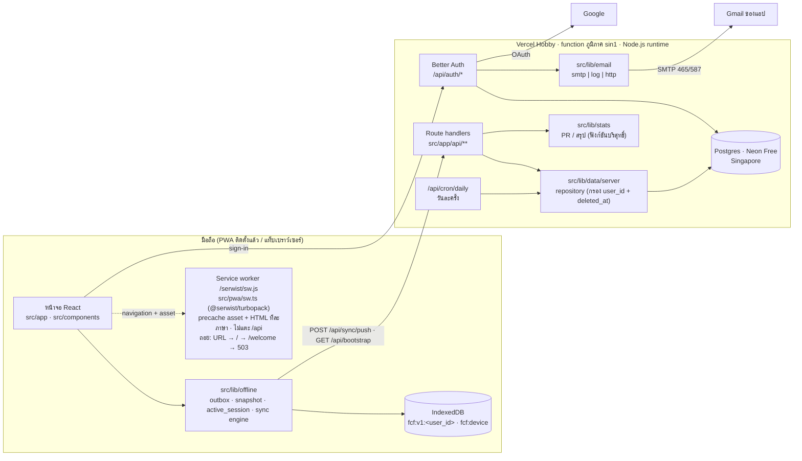
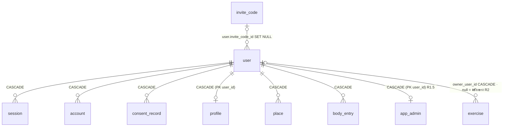

# ARCHITECTURE — แมวอ้วนจะผอม (Fat Cat Fit) v1

> ร่าง 1 · 2026-11-15 · ผู้เขียน: architect · สถานะ: **อนุมัติโดย boss 2026-11-16** พร้อม ADR 0001–0004 · **ร่าง 2 · 2026-11-17**: ปรับให้ตรงกับโค้ดจริงหลัง R0 · **ร่าง 3 · 2026-11-18**: ตาม ADR 0006 และ ADR 0002 ที่แก้ 2026-11-18 (ดูบันทึกการแก้ไขท้ายไฟล์) · **ร่าง 4 · 2026-11-20**: หน้าแอดมินออกโค้ดเชิญ (R1.5 · ADR 0007) · **ร่าง 5 · 2026-11-23**: คลังท่า สถานที่ และ API เขียนชุดแรก (R2 · ADR 0008 · กำลังทำ — โฟลเดอร์/ตารางที่ระบุ "R2" ยังไม่อยู่ใน `main`)
> เอกสารนี้เป็นภาพรวมหน้าเดียว รายละเอียดและเหตุผลอยู่ใน ADR: [0001 ฐานข้อมูล/โฮสต์](../adr/0001-database-and-hosting.md) · [0002 auth](../adr/0002-auth.md) · [0003 โมเดลข้อมูล](../adr/0003-data-model.md) · [0004 ออฟไลน์/sync](../adr/0004-offline-sync.md) · [0005 service worker](../adr/0005-service-worker-tool.md) · [0006 การพาไปจอตามสถานะบัญชี + ยินดีต้อนรับออฟไลน์](../adr/0006-auth-routing-offline.md) · [0007 สิทธิ์แอดมินและหน้าออกโค้ดเชิญ](../adr/0007-admin-invites.md) · [0008 คลังท่ากลาง](../adr/0008-exercise-catalog.md)
> boss เลือก Neon (Singapore) ตาม ADR 0001 · Vercel function ต้องตั้งภูมิภาค `sin1`

## 1. แผนภาพส่วนประกอบ



หลักการเดินข้อมูล: หน้าจอ **อ่าน** จาก snapshot + คิวในเครื่อง และ **เขียน** ผ่าน `src/lib/offline` เท่านั้น → คิวส่งไป `/api/sync/push` → เซิร์ฟเวอร์ upsert แบบส่งซ้ำได้ → ดึง `/api/bootstrap` มาแทน snapshot · ข้อยกเว้นที่ต้องออนไลน์และเรียก API ตรง: เข้าสู่ระบบ, consent, ส่งออก, ลบบัญชี, ประวัติเก่ากว่า 60 วัน, กราฟ

หลักการ render (ผลของ R0): ทุกหน้าเป็น dynamic เพราะภาษาอ่านจาก cookie `NEXT_LOCALE` · HTML ของหน้าถูก SW เก็บไว้ใช้ตอนออฟไลน์ → **HTML ห้ามมีข้อมูลส่วนตัว** ข้อมูลผู้ใช้โหลดฝั่งไคลเอนต์เท่านั้น และหน้าตรวจสถานะล็อกอินฝั่งไคลเอนต์ด้วยเสมอ (ADR 0005 กติกา 1)

### 1.1 จอและการพาไปจอที่ถูก (ADR 0006 · ไม่ใช้ `proxy.ts`)

| route group | path | เซิร์ฟเวอร์ (layout ของกลุ่ม) | ใน `OFFLINE_PAGES` |
|---|---|---|---|
| `(public)` — kind `public` | `/welcome` (โค้ดเชิญ · Google · อีเมล → OTP เป็นขั้นในหน้าเดียว · ลิงก์เชิญ `/welcome#invite=…`) | ไม่ redirect · HTML เหมือนกันทุกสถานะ | ใช่ |
| `(setup)` — kind `setup` | `/consent` · `/onboarding` | ไม่มี cookie session → 307 `/welcome` | ไม่ |
| `(app)` — kind `app` (มีแถบล่าง) | `/` `/history` `/progress` `/me` | ไม่มี cookie session → 307 `/welcome` | ใช่ |
| `(admin)` — kind `app` (ไม่มีแถบล่าง · ข้อยกเว้น ADR 0007) | `/admin/invites` (R1.5 · แอดมินเท่านั้น · ทางเข้าคือแถวในหน้า "ฉัน" ที่เห็นเมื่อ `/api/me` ตอบ `isAdmin: true`) | ไม่มี cookie → 307 `/welcome` · มี cookie → หน้าเรียก `requireAdmin()` (query DB) ไม่ผ่าน → 404 (`notFound()` · Next 16 ตอบ error shell แล้ววาด 404 ใน layout ของกลุ่ม จึงแยกกลุ่มไม่ให้มีแถบล่าง) | **ไม่** · SW ไม่เก็บทุก path ใต้ `/admin` |
| ไม่มีด่าน (`open`) | `/privacy` · `/styleguide` · not-found · error | — | ไม่ |

- เซิร์ฟเวอร์ตรวจแค่ "มี cookie session ไหม" ด้วย `hasSessionCookie()` (`src/lib/auth/session-cookie.ts` ห่อ `getSessionCookie` ของ `better-auth/cookies`) — ไม่ query DB ไม่อ่านข้อมูลจาก session · ห้ามมี `loading.tsx`/Suspense ครอบ layout ที่ redirect (ได้ 200 + meta refresh ที่ SW จะเก็บ) — root `(app)` `(setup)` `(admin)` · `(admin)` ห้าม `not-found.tsx` ด้วย
- ไคลเอนต์ `AuthGate` (`src/components/auth/**`) รับ `kind` จาก layout เรียก `GET /api/me` แล้วพาไป `/welcome` · `/consent` · `/onboarding` · `/` ตามตาราง `decideRoute` ของ ADR 0006 ข้อ 3 · ออฟไลน์ไม่เปลี่ยนหน้า: hint `fcf:auth = ready` → แสดงหน้า · ไม่มี → จอยินดีต้อนรับแบบออฟไลน์ในที่เดิม (hint อ่าน/เขียนผ่าน `src/pwa/auth-hint.ts`)
- ออกจากระบบ/ลบบัญชี: เรียกเซิร์ฟเวอร์สำเร็จ → `resetDeviceAfterSignOut()` (`src/pwa`) → `location.replace("/welcome")`

### 1.2 ตารางในฐานข้อมูล (migration `0000`–`0002` + `0003` ของ R2 · ตารางของรอบถัดไปและคอลัมน์เต็มอยู่ใน ADR 0003 ข้อ 3, 3.1)



`exercise` (R2): ตารางเดียวเก็บทั้งคลังกลาง (`owner_user_id` null · seed จาก `content/exercises/**` · ไม่ลบ เลิกใช้ = `archived_at`) และท่าของฉัน (เขียนผ่าน push) · เพดานต่อคน: ท่าของฉัน 300 · สถานที่ 30 (ADR 0003 ข้อ 3.1)

ไม่ผูกผู้ใช้ด้วย FK: `verification` (OTP · ลบด้วย identifier ตรงตัวตอนลบบัญชี) · `rate_limit` (Better Auth ต่อ IP) · `auth_throttle` (key เป็น hash · ลบ `otp-email:` และ `admin-invite:` ตอนลบบัญชี) · `invite_code` ไม่มี `user_id` · `app_admin` แอปอ่านอย่างเดียว เพิ่ม/ถอนด้วย SQL (ADR 0007)

## 2. โครงโฟลเดอร์และเจ้าของ (ตรงกับ TEAM.md)

โครงจริง ณ ปลาย R0 (โฟลเดอร์ที่ยังไม่มีระบุรอบที่จะสร้าง)

```
src/
  app/                      frontend — หน้าจอ (App Router, ไม่มี locale ใน URL) · layout.tsx (html/body + ServiceWorkerRegister)
    (public)/welcome/       R1 · จอยินดีต้อนรับ (ข้อ 1.1)
    (setup)/consent/ onboarding/   R1 · layout ตรวจ cookie session
    (app)/                  layout ตรวจ cookie session + แถบล่าง · page.tsx (หน้าหลัก), history/, progress/, me/ (ย้ายจาก R0 ใน R1 — URL ไม่เปลี่ยน)
    (admin)/                R1.5 · layout ตรวจ cookie session + AuthGate kind app · ไม่มีแถบล่าง · ห้าม loading.tsx/Suspense/not-found.tsx
      admin/invites/        R1.5 · หน้าแอดมินออกโค้ดเชิญ (เรียก requireAdmin → notFound · ADR 0007 ข้อ 4)
    privacy/ styleguide/    ไม่มีด่าน
    api/                    platform — route handlers
      health/               R0 · GET /api/health
      auth/[...all]/        Better Auth handler (R1)
      invite/check/ consent/ onboarding/ me/ cron/daily/   R1
      admin/invites/        R1.5 · GET/POST · [id]/revoke/ POST (ADR 0007)
      catalog/ bootstrap/ sync/push/   R2 · คลังกลาง · snapshot · push (ADR 0004 ข้อ 4 · ADR 0008)
    serwist/[path]/         pwa-offline — route.ts สร้าง /serwist/sw.js ตอน build (ADR 0005)
  components/               frontend
    auth/                   R1 · AuthGate, decideRoute, จอยินดีต้อนรับแบบออฟไลน์
    ui/                     ปุ่ม ชิป ช่องตัวเลข ✓ เส้นคั่นวาดมือ empty state ฯลฯ
    nav/                    แถบล่าง 4 แท็บ
    theme/                  โหมดสว่าง/มืด + ตัวสลับภาษา
    styleguide/             เนื้อหาหน้า /styleguide
    doodle/                 ux-brand — ภาพแมว SVG (Cat.tsx, poses.generated.ts)
  db/                       platform — client.ts, schema/ (auth.ts, invite.ts, app.ts, index.ts · R1.5: admin.ts), sql-helpers.ts, migrations.test.ts
    testing/                platform — pglite.ts: ฐานข้อมูลเทสต์ (PGlite + migration จริง) ใช้ใน *.test.ts เท่านั้น
  lib/
    data/shared/            platform (R1+) — track-types, units, zod schema, ชนิดข้อมูลบนสาย · R1.5: admin-invite.ts (zod ของฟอร์มออกโค้ด ใช้ร่วมหน้า/API) · R2: exercise-meta.ts (หมวด/อุปกรณ์/ชุดข้อมูล — ที่เดียว) · exercise-search.ts (ค้นฝั่งไคลเอนต์ ฟังก์ชันบริสุทธิ์)
    data/server/            platform — repository (import 'server-only') · R0 มี health.ts
    stats/                  platform (R3+) — สถิติ/PR ฟังก์ชันบริสุทธิ์
    auth/                   platform — server.ts (R0: createAuth · R1: requireUser, requireConsent), session-cookie.ts (R1 · hasSessionCookie ไม่ import db), client.ts (R1), http.ts (json/handle/assertSameOrigin), throttle.ts, invite-store.ts · R1.5: admin.ts (requireAdmin, isAdmin · server-only)
    email/                  ops-release (R1)
    offline/                pwa-offline (R1 แบบส่งทันที · R3 outbox)
    i18n/                   frontend — config.ts, request.ts (อ่าน cookie), client.ts
  pwa/                      pwa-offline — sw.ts, strategy.ts (กติกา cache ไม่มี I/O), register.tsx, clear-caches.ts, messages.ts · R1: auth-hint.ts, resetDeviceAfterSignOut, useOnline (ตัวตรวจเน็ตตัวเดียว)
    e2e/                    pwa-offline — s5-offline-check.ts สคริปต์ตรวจออฟไลน์/อัปเดต/ภาษาใน Chromium (รันเอง ไม่อยู่ใน CI)
  test/                     ตัวช่วยของ Vitest (stub `server-only`)
public/                     manifest.webmanifest (pwa-offline) · icons/ (ux-brand)
drizzle/                    platform — migration SQL + meta/ (0000_auth_init.sql · 0001_r1_invite_consent_profile.sql · R1.5: 0002_* ตาราง app_admin · R2: 0003_* ตาราง exercise)
content/exercises/          catalog (R2) — *.json แถวคลัง (UUID คงที่) + SOURCES.md (ชุดข้อมูล · commit ที่ล็อก · ใบอนุญาต) · ไม่มี instructions/รูป (ADR 0008)
messages/                   frontend — th.json, en.json
scripts/                    db-migrate.ts (platform) · release.ts, release-lib.ts, release-notes.ts, release-migrate.ts (ops) · export-stickers.mjs, export-icons.mjs, cat-source.mjs (ux-brand) · invite.ts (R1) · seed*.ts (R2 catalog: แปลง, seed รันซ้ำได้, ตรวจคลัง · release-migrate เรียก seed ต่อจาก migrate) · เทสต์ของ ops: env-example, eslint-boundaries, security-headers
tests/e2e/                  qa-test (smoke, design, pwa)
.github/                    ops-release — ci.yml, release.yml, dependabot.yml
next.config.ts · vercel.json · eslint.config.mjs   ops-release
drizzle.config.ts · vitest.config.ts · tsconfig.json   platform · playwright.config.ts   qa-test
```

unit/integration test วางคู่กับไฟล์ (`*.test.ts`) ในโฟลเดอร์ของเจ้าของ · E2E อยู่ `tests/e2e/`

## 3. ขอบเขตโมดูล (ใครเรียกใครได้)

| โมดูล | import ได้ | ห้าม import |
|---|---|---|
| `src/app/**` (หน้าจอ), `src/components/**` | components, doodle, i18n, `lib/offline`, `lib/data/shared`, `lib/stats`, `lib/auth/client`, `src/pwa/register` (layout), `src/pwa/clear-caches` · `auth-hint` · `resetDeviceAfterSignOut` · `useOnline` (R1) · `lib/auth/session-cookie` (เฉพาะ layout ฝั่งเซิร์ฟเวอร์ของ `(app)`/`(setup)`/`(admin)`) · `lib/auth/admin` (เฉพาะ `src/app/(admin)/admin/**/page.tsx` — ข้อตกลง ESLint ไม่ได้บังคับเจาะจง · ADR 0007) | `src/db`, `lib/data/server`, `lib/auth/server`, `lib/email` |
| `src/lib/offline/**` | `lib/data/shared`, `lib/stats` · คุยกับเซิร์ฟเวอร์ด้วย `fetch` เท่านั้น | ทุกอย่างฝั่งเซิร์ฟเวอร์, React component |
| `src/app/api/**` | `lib/auth/server`, `lib/data/server`, `lib/data/shared`, `lib/stats`, `lib/email` | `src/db` ตรงๆ (ผ่าน repository) |
| `src/lib/data/server/**` | `src/db`, `lib/data/shared`, `lib/stats` | `src/app` |
| `src/lib/auth/**` | `src/db`, `lib/email`, `lib/data/shared` | `src/app` |
| `src/lib/stats/**`, `src/lib/data/shared/**` | กันเองเท่านั้น (ไม่มี I/O) | ทุกอย่างที่มี I/O |
| `src/pwa/**` | ไฟล์ใน `src/pwa` ด้วยกัน (relative) · แพ็กเกจ `serwist` (ใน `sw.ts`) · `react` (ใน `register.tsx`) | ทุกอย่างผ่าน alias `@/` (กฎ ESLint `boundaries/pwa`) · `server-only` |
| `src/db/testing/**` | `src/db` | ห้าม import จากโค้ดแอป — ใช้ใน `*.test.ts` เท่านั้น (ข้อตกลง ยังไม่มีกฎ ESLint) |

บังคับด้วย: `import 'server-only'` ในโมดูลฝั่งเซิร์ฟเวอร์ + กฎ ESLint `no-restricted-imports` ใน `eslint.config.mjs` (ops ตั้งใน R0, มีเทสต์ `scripts/eslint-boundaries.test.ts`; ไฟล์ `*.test.*` ได้รับยกเว้น) · **ไม่ใช้ Server Actions เขียนข้อมูลใน v1** — ทุกการเขียนเป็น HTTP endpoint เพื่อให้คิวออฟไลน์ใช้ทางเดียวกัน · ทุก route handler ข้อมูลเริ่มด้วย `requireUser()` แล้ว `requireConsent()` และส่ง `userId` ให้ repository (repository ไม่รับ query ที่ไม่มี `userId`)

## 4. API ระดับสูงของ v1

| method · path | ทำอะไร | ออนไลน์เท่านั้น | รอบ |
|---|---|---|---|
| `GET /api/health` | ตรวจแอป + query ฐานข้อมูล 1 ครั้ง · 200 `{ok:true}` / 503 `{ok:false}` | — | R0 |
| `GET /serwist/sw.js` | ไฟล์ service worker (สร้างตอน build, `Cache-Control: no-cache, no-store, must-revalidate`) — ไม่ใช่ API แต่ URL นี้ตายตัว (ADR 0005) | — | R0 |
| `* /api/auth/*` | Better Auth: Google (`callbackURL "/"` · `errorCallbackURL "/welcome"` · `prompt: "select_account"` ตั้งแต่ v0.2.1), email OTP ส่ง/ยืนยัน, sign-out, get-session · ส่ง OTP ผ่านจุดกั้นก่อนส่ง (ADR 0002 ข้อ 2: อีเมลไม่มีบัญชี + ไม่มี `fcf_invite` ที่ active → 200 `{success:true}` เหมือนส่งจริง แต่ไม่ส่งเมล) · rate limit ต่อ IP ด้วย `rateLimit.customRules` · 429 + `X-Retry-After` · เพดานรายวันเต็ม → 503 `email_unavailable` · `user.deleteUser` **ไม่เปิด** | ✓ | R1 |
| `POST /api/invite/check` | ตรวจโค้ดเชิญ (โค้ดใน body เท่านั้น · ไม่ใช้สิทธิ์) + ตั้ง cookie `fcf_invite` · `ok` / `invalid` · จำกัดต่อ IP ด้วย `auth_throttle` key `invite-ip:` | ✓ | R1 |
| `GET /api/me` | 401 = ไม่ล็อกอิน · 200 `{ state: "consent_required" \| "onboarding_required" \| "ready", user, …, isAdmin }` (`isAdmin` R1.5 — แสดงแถวทางเข้าหน้าแอดมินเท่านั้น) · `Cache-Control: no-store` · ไม่ต้อง consent · AuthGate ใช้ตัดสินจอ (ADR 0006) | — | R1 · R1.5 |
| `POST /api/consent` | บันทึก consent ของ `PRIVACY_NOTICE_VERSION` | ✓ | R1 |
| `POST /api/onboarding` | profile + place แรก + body_entry แรก ใน transaction เดียว | ✓ | R1 |
| `DELETE /api/me` | ลบบัญชีและข้อมูลทั้งหมด: ใน transaction เดียว ลบ `verification` ด้วย identifier ตรงตัว `<type>-otp-<email>` (ไม่ใช้ `LIKE`) + `auth_throttle` `otp-email:` (+ `admin-invite:` ตั้งแต่ R1.5) → ตั้ง `label` ของโค้ดที่บัญชีใช้สมัครเป็น `—` (R1.5) → ลบ `user` (cascade รวม `app_admin`) · ล้าง cookie session (ADR 0002 ข้อ 7) | ✓ | R1 |
| `GET /api/admin/invites` | แอดมิน: รายการโค้ด `{ invites: [{ id, label, status, usesCount, maxUses, expiresAt, createdAt }] }` ใหม่สุดก่อน ≤ 200 แถว · **ไม่มีโค้ด/hash** · ลำดับตรวจ: `requireAdmin` | ✓ | R1.5 |
| `POST /api/admin/invites` | แอดมิน: ออกโค้ด body `{ label, days, maxUses }` (D3: 1/3/7/14 วัน · 1–10 ครั้ง · ป้าย 1–40 ตัว) → 201 `{ id, code, label, maxUses, expiresAt }` (โค้ดดิบครั้งเดียว) · ลำดับตรวจ: Origin แบบเข้ม → `requireAdmin` → throttle 20/24 ชม. (`admin-invite:`) → body → zod | ✓ | R1.5 |
| `POST /api/admin/invites/:id/revoke` | แอดมิน: เพิกถอน → `{ result: "revoked" \| "unchanged" }` (ส่งซ้ำได้) · ไม่พบ 404 · ลำดับตรวจ: Origin แบบเข้ม → `requireAdmin` → id เป็น UUID | ✓ | R1.5 |
| `POST /api/sync/push` | รับรายการ upsert/delete แบบส่งซ้ำได้ `{ v:1, ops }` → `{ results, server_time }` (ADR 0004 ข้อ 4) · entity เพิ่มตามรอบ: **R2 `place` `exercise`** · R3 session/session_exercise/set · R4 template, body_measurement · `profile` `body_entry` เพิ่มในรอบที่มีจอแก้ข้อมูลนั้น · code ปฏิเสธเพิ่ม `limit_reached` (R2) · zod strict ช่องที่เซิร์ฟเวอร์ตั้งเอง = `invalid` · ท่าคลัง/ของคนอื่น = `id_conflict` · `place` ลบไม่ได้และต้องเหลือแห่งที่ไม่อยู่ในกรุ ≥ 1 | — | R2 → R4 |
| `GET /api/bootstrap` | snapshot ของผู้ใช้ · R2: `{ profile, places, my_exercises, catalog_version, server_time }` (รวมแถวในกรุ ไม่รวมแถวที่ลบ) · R3+: สถิติดีสุด/ค่าครั้งก่อนต่อท่า เซสชัน ฯลฯ ตาม ADR 0004 ข้อ 2 | — | R2 → R4 |
| `GET /api/catalog` | ทุกแถวคลังกลาง (รวมในกรุ) `{ catalog_version, exercises }` · ไม่ส่ง `source_ref` `license` `attribution` `met` · `ETag: "<catalog_version>"` + `If-None-Match` → 304 (ADR 0008 ข้อ 5) · ค้นท่าทำฝั่งไคลเอนต์ ไม่มี API ค้น | — | R2 |
| `GET /api/sessions?before=&limit=` · `GET /api/sessions/:id` | ประวัติ (เก่ากว่า snapshot) / รายละเอียด | ✓ | R3 |
| `GET /api/stats/summary?period=week\|month&anchor=YYYY-MM-DD` | วันที่มา · จำนวนเซสชัน · เวลารวม | ✓ (มีสำเนาล่าสุด) | R5 |
| `GET /api/stats/exercise/:id?range=` | ข้อมูลกราฟ + สถิติรายท่า | ✓ | R5 |
| `GET /api/body-entries?range=` | กราฟน้ำหนักตัว/สัดส่วน | ✓ | R4/R5 |
| `GET /api/export` | ไฟล์ CSV ทุกตารางของผู้ใช้ (รูปแบบไฟล์ใน contract R5) | ✓ | R5 |
| `GET /api/cron/daily` | ล้าง OTP/rate limit/throttle หมดอายุ (ตรวจ secret ของ cron) | — | R1 |

ทุก endpoint ข้อมูล: ตอบ JSON · `Cache-Control: no-store` (`json()` ใน `src/lib/auth/http.ts`) · เวลาเป็น ISO-8601 UTC · ข้อผิดพลาดรูปแบบ `{ code, ...extra }` (`HttpError` ใน `src/lib/data/shared/http-error.ts` — ไม่มีข้อความภาษามนุษย์) · code คงที่ให้ UI แปลด้วย next-intl · มีเทสต์ "ผู้ใช้ A อ่าน/แก้ของ B ไม่ได้" (เกตสิทธิ์ข้อมูล) · คำขอที่เปลี่ยนข้อมูลผ่าน `assertSameOrigin()` (API แอดมินใช้แบบเข้ม: ต้องมี `Origin`)

**API แอดมิน (`/api/admin/**` · ADR 0007)**: ไม่ผ่าน `requireAdmin()` ทุกกรณี (ไม่มี session / หมดอายุ / ไม่ใช่แอดมิน / method ที่ไม่มี รวม `OPTIONS` ที่ export ไว้ตอบ 404) → 404 `{ code: "not_found" }` เหมือนกันทุกไบต์ · `HEAD` ใช้ handler `GET` (body ว่าง) · ตรวจสิทธิ์ก่อนอ่าน body เสมอ · ไม่เรียก `requireConsent()` · สิทธิ์อ่านจากตาราง `app_admin` ทุกคำขอ (ไม่ cache) · ไม่มี API ใดเขียน `app_admin`

ยังไม่มีคิวเต็มรูปก่อน R3: R1 เขียนผ่าน `POST /api/onboarding` · R2 เขียน `place`/`exercise` ผ่าน `/api/sync/push` ด้วยฟังก์ชันใน `src/lib/offline` ที่ส่งทันทีตอนออนไลน์และแจ้งข้อผิดพลาด (ล้ม = ค่าอยู่ในฟอร์ม + ลองใหม่) แล้ว R3 เปลี่ยนไส้ในเป็น outbox โดยหน้าจอไม่ต้องแก้ · R2 ยังไม่เก็บคลังหรือ snapshot ใน IndexedDB (R3)

## 5. ตัวแปร env (ใส่ใน `.env.example` โดยไม่มีค่าจริง)

| ตัวแปร | ใช้ที่ | หมายเหตุ |
|---|---|---|
| `DATABASE_URL` | db (แอปตอนรัน) | connection string แบบ pooled ของ Neon |
| `DATABASE_URL_UNPOOLED` | `npm run db:migrate` (ถ้าไม่มีถอยไป `DATABASE_URL`) · `scripts/release-migrate.ts` (ต้องมี ไม่ถอย) | direct (ไม่มี `-pooler`) — migration และ advisory lock ต้องใช้ session จริง |
| `MIGRATE_ON_DEPLOY` | `scripts/release-migrate.ts` | ตั้ง `1` เฉพาะ Vercel Production เพื่อให้ build รัน migration · ไม่ตั้ง = ข้าม · ทำงานคู่กับ `VERCEL_ENV=production` ที่ Vercel ตั้งให้เอง |
| `BETTER_AUTH_SECRET` | auth | สุ่มยาว ≥ 32 ตัว ต่างกันระหว่าง production กับ preview/dev |
| `BETTER_AUTH_URL` | auth | URL เต็มของ production (ไม่ตั้ง = redirect_uri_mismatch) · Preview ไม่ตั้ง — Better Auth ใช้ origin ของคำขอ (2026-11-22) |
| `GOOGLE_CLIENT_ID` · `GOOGLE_CLIENT_SECRET` | auth | boss สร้าง OAuth client |
| `EMAIL_TRANSPORT` | email | `smtp` \| `log` \| `http` |
| `EMAIL_FROM` | email | ชื่อ + ที่อยู่ผู้ส่ง |
| `SMTP_HOST` · `SMTP_PORT` · `SMTP_USER` · `SMTP_PASS` | email | Gmail app password · `smtp.gmail.com` 465 (SSL) / 587 (STARTTLS) — ยืนยันแล้ว 2026-11-18 (ADR 0002 ข้อ 4) |
| `OTP_DAILY_CAP` | auth | ค่าเริ่ม 400 (ฐาน 500/วัน · เอกสาร Google ขัดกัน 500 กับ 2,000) · นับตามวัน UTC |
| `CRON_SECRET` | cron | วิธีที่ Vercel ส่ง secret ให้ cron — ops ยืนยันจากเอกสาร Vercel ใน R1 |
| `S5_CHANNEL` | `src/pwa/e2e/s5-offline-check.ts` เท่านั้น | ช่องเบราว์เซอร์ของ Playwright (เช่น `chrome`) · ไม่ใช้ในแอป |

ไม่ใช่ env: header IP ใช้ค่าเริ่มของ Better Auth `x-forwarded-for` (Vercel เขียนทับ — ADR 0002 ข้อ 3) จึง**ไม่มี** `TRUSTED_IP_HEADER` · ภาษาเก็บใน **cookie `NEXT_LOCALE`** (`th` | `en`, ค่าเริ่ม/ค่าไม่รู้จัก = `th`, อายุ 1 ปี) อ่านโดย `src/lib/i18n/request.ts` · ภาษาของอีเมล OTP = `profile.locale` → cookie `NEXT_LOCALE` → `th` · ตัวแปรที่ R0 อ่านจริง: `DATABASE_URL`, `DATABASE_URL_UNPOOLED`, `BETTER_AUTH_SECRET`, `MIGRATE_ON_DEPLOY` · ที่เหลือเริ่มใช้ R1 (อยู่ใน `.env.example` แบบ comment)

## 6. เวอร์ชันของไลบรารีหลัก (ที่ติดตั้งจริงตาม `package.json` ณ 2026-11-17)

| แพ็กเกจ | รุ่นที่ปัก | หมายเหตุ |
|---|---|---|
| Node.js | `engines.node: "26.x"` | S6: Vercel รองรับ 26.x (ค่าเริ่ม) 24.x 22.x · CI ใช้ 26.x ตรงกัน (`docs/OPERATIONS.md` ข้อ 2.1) |
| `next` · `eslint-config-next` | `~16.4.6` | Turbopack (dev และ build) |
| `react` / `react-dom` | `^19.3.1` | ตาม peer ของ Next |
| `typescript` | `~5.9.3` | **ปักที่ 5.9 โดยตั้งใจ** (npm latest เป็น 7.0 ณ R0 — ตามรายงาน platform) · ขยับเป็นงาน chore |
| `eslint` | `^9.39.5` | ESLint 9 ตาม peer ของ eslint-config-next |
| `drizzle-orm` / `drizzle-kit` | `~0.45.4` / `~0.31.11` | คู่กัน · 1.0 ยังเป็น rc |
| `better-auth` + `@better-auth/drizzle-adapter` | `~1.7.25` | `generateId` แบบฟังก์ชัน (ADR 0002) |
| `next-intl` | `~4.15.1` | ไม่มี locale ใน URL ไม่ใช้ middleware/proxy (S4) |
| `tailwindcss` · `@tailwindcss/postcss` | `~4.3.5` | ต้อง Safari 16.4+/Chrome 111+ |
| `@serwist/turbopack` · `serwist` · `esbuild` | `~9.5.14` · `~9.5.14` · `~0.28.2` | **ADR 0005** (ทาง A) · อยู่ใน devDependencies (ใช้ตอน build) |
| `pg` · `@electric-sql/pglite` | `^8.23.1` · `^0.5.16` | PGlite ใช้ในเทสต์เท่านั้น (S1) |
| `zod` · `idb` | `^4.6.7` · `^8.0.4` | |
| `vitest` · `@playwright/test` · `jsdom` · `tsx` | `^5.1.0` · `^1.65.1` · `^31.0.1` · `^4.23.15` | |
| `nodemailer` | ยังไม่ติดตั้ง | R1 (ชั้นส่งอีเมล) |

ปักรุ่นแบบ `~` (patch) สำหรับ next, better-auth, drizzle, serwist, next-intl, tailwind, typescript · อัปรุ่น minor เป็นงาน chore ที่ผ่านเกตครบ (อัป serwist/next ต้องรันสคริปต์ S5 ซ้ำ · อัป better-auth ต้องเทียบ schema ตาม ADR 0002)

## 7. สภาพแวดล้อม

| | ฐานข้อมูล | migration | service worker | อีเมล | URL |
|---|---|---|---|---|---|
| เครื่องนักพัฒนา (`next dev`) | Neon `dev` | Lead/platform รัน `npm run db:migrate` | ไม่ลงทะเบียน | `log` | `http://localhost:3000` |
| เทสต์/CI (Vitest) | PGlite ในโปรเซส รัน migration จาก `drizzle/` ทุกครั้ง · ไม่มี container | อัตโนมัติในเทสต์ + `drizzle-kit check` | — | `log` | — |
| ตรวจ SW ในเครื่อง | — | — | `npm run build` + `src/pwa/e2e/s5-offline-check.ts` (`next start` หลัง proxy พอร์ต 3102) | — | `http://localhost:3102` |
| Vercel preview | Neon `dev` | ไม่รันอัตโนมัติ (Lead รัน `db:migrate` กับ `dev` ก่อนทดสอบ PR ที่มี migration) | ลงทะเบียน | `log` หรือ `smtp` ไปยังอีเมลทดสอบ | URL preview (ต้องเพิ่มใน Google OAuth ถ้าจะทดสอบ Google) |
| Vercel production | Neon `production` | ขั้น build ของ Vercel เมื่อ `MIGRATE_ON_DEPLOY=1` (ยังไม่เปิด) | ลงทะเบียน | `smtp` | โดเมน Vercel ของโปรเจกต์ |

ทุกสภาพแวดล้อมบน Vercel: function ภูมิภาค `sin1` · Node 26.x · security headers จาก `next.config.ts` (CSP ไม่ใช้ nonce ณ R0 — `docs/OPERATIONS.md` ข้อ 3)

## บันทึกการแก้ไข

| วันที่ | สิ่งที่แก้ | เหตุผล |
|---|---|---|
| 2026-11-17 | แผนภาพ SW · หลักการ render · โครงโฟลเดอร์จริง · ขอบเขตโมดูลของ `src/pwa` และ `src/db/testing` · `/serwist/sw.js` ในตาราง API · env (`DATABASE_URL_UNPOOLED` ใช้จริง, เพิ่ม `MIGRATE_ON_DEPLOY`, `S5_CHANNEL`, cookie `NEXT_LOCALE`) · รุ่นแพ็กเกจที่ติดตั้ง · ตารางสภาพแวดล้อม | ให้ตรงกับโค้ดหลัง R0 และผล spike S1 S2 S4 S5 S6 · ไม่เปลี่ยนการตัดสินใจนอกจากที่บันทึกใน ADR 0001, 0004, 0005 |
| 2026-11-18 | เพิ่มข้อ 1.1 (จอ · route group `(public)` `(setup)` `(app)` · ใครตรวจอะไร · ไม่ใช้ `proxy.ts`) · แผนภาพ SW (ถอยไป `/welcome`) · โครงโฟลเดอร์ R1 (`(public)/welcome`, `(setup)`, `(app)`, `components/auth`, `lib/auth/session-cookie.ts`, ไฟล์ใหม่ใน `src/pwa`) · ขอบเขตโมดูลของหน้าจอ · ตาราง API (`/api/me` รูปคำตอบ, จุดกั้น OTP, `customRules`, `X-Retry-After`, `email_unavailable` 503, `POST /api/onboarding`, วิธีลบ `verification`, invite จำกัดด้วย `auth_throttle`) · env: ลบ `TRUSTED_IP_HEADER`, Gmail host/port ยืนยันแล้ว | ADR 0006 และ ADR 0002 แก้ไข 2026-11-18 · ไม่มีการตัดสินใจใหม่ในไฟล์นี้ |
| 2026-11-20 | ข้อ 1.1 แถว `/admin/invites` · เพิ่มข้อ 1.2 ตารางที่มีจริง + ความสัมพันธ์ (รวม `app_admin`) · โครงโฟลเดอร์ (`admin/` ทั้งหน้าและ API, `lib/auth/admin.ts`, `data/shared/admin-invite.ts`, `schema/admin.ts`, migration `0001`/`0002`, route ของ R1 ที่ตกหล่น) · ขอบเขตโมดูล (`lib/auth/admin` ให้หน้าแอดมิน) · ตาราง API 3 เส้นทางแอดมิน + `isAdmin` + ลบ key `admin-invite:` · **แก้รูปข้อผิดพลาดให้ตรงโค้ด** `{ code, ...extra }` (เดิมเขียน `{ error: { code, message } }` ซึ่งไม่เคยตรงกับ `HttpError`) | ADR 0007 (R1.5 contract ที่ boss อนุมัติ 2026-11-20) · ตรวจกับโค้ด `src/lib/auth/http.ts` `src/lib/data/shared/http-error.ts` · ไม่มีการตัดสินใจใหม่ในไฟล์นี้ |
| 2026-11-20 | ข้อ 1.1 + โครงโฟลเดอร์ + ขอบเขตโมดูล: หน้าแอดมินอยู่กลุ่ม `(admin)` (ไม่มีแถบล่าง) แทน `(app)/admin` · กลุ่มที่ห้าม loading/Suspense · API แอดมิน `OPTIONS`/`HEAD` · `DELETE /api/me` ล้างป้ายโค้ดที่ใช้สมัคร | ADR 0007 แก้ไข 2026-11-20 (commit 96449fa · boss ตัดสินเกณฑ์ 3 และ M1 ทาง ก.) · ไม่มีการตัดสินใจใหม่ในไฟล์นี้ |
| 2026-11-23 | ร่าง 5: ลิงก์ ADR 0008 · ข้อ 1.2 เพิ่ม `exercise` + เพดานต่อคน · โครงโฟลเดอร์ (API `catalog/` `bootstrap/` `sync/push/`, `exercise-meta.ts` `exercise-search.ts`, migration `0003`, `content/exercises/`, `seed*.ts`) · ตาราง API: push เริ่ม R2 กับ `place` `exercise` (**แก้ของเดิมที่เขียนว่า R1 มี push** — R1 เขียนผ่าน `/api/onboarding`), bootstrap รูป R2, catalog ETag/304 · ย่อหน้าการเขียนก่อน R3 | R2 contract ที่ boss อนุมัติ 2026-11-23 · ADR 0008 · ADR 0003/0004 แก้ไข 2026-11-23 · ไม่มีการตัดสินใจใหม่ในไฟล์นี้ |

