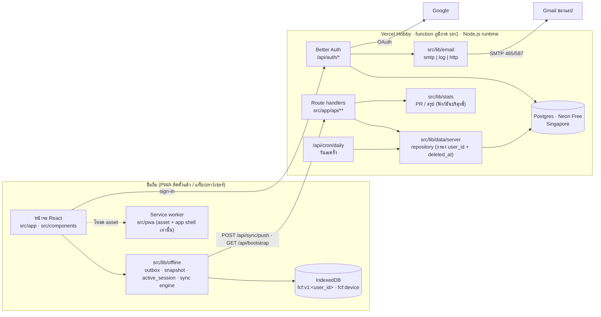

# ARCHITECTURE — แมวอ้วนจะผอม (Fat Cat Fit) v1

> ร่าง 1 · 2026-11-15 · ผู้เขียน: architect · สถานะ: **อนุมัติโดย boss 2026-11-16** พร้อม ADR 0001–0004
> เอกสารนี้เป็นภาพรวมหน้าเดียว รายละเอียดและเหตุผลอยู่ใน ADR: [0001 ฐานข้อมูล/โฮสต์](../adr/0001-database-and-hosting.md) · [0002 auth](../adr/0002-auth.md) · [0003 โมเดลข้อมูล](../adr/0003-data-model.md) · [0004 ออฟไลน์/sync](../adr/0004-offline-sync.md)
> boss เลือก Neon (Singapore) ตาม ADR 0001 · Vercel function ต้องตั้งภูมิภาค `sin1`

## 1. แผนภาพส่วนประกอบ



หลักการเดินข้อมูล: หน้าจอ **อ่าน** จาก snapshot + คิวในเครื่อง และ **เขียน** ผ่าน `src/lib/offline` เท่านั้น → คิวส่งไป `/api/sync/push` → เซิร์ฟเวอร์ upsert แบบส่งซ้ำได้ → ดึง `/api/bootstrap` มาแทน snapshot · ข้อยกเว้นที่ต้องออนไลน์และเรียก API ตรง: เข้าสู่ระบบ, consent, ส่งออก, ลบบัญชี, ประวัติเก่ากว่า 60 วัน, กราฟ

## 2. โครงโฟลเดอร์และเจ้าของ (ตรงกับ TEAM.md)

```
src/
  app/                      frontend — หน้าจอทั้งหมด (App Router, ไม่มี locale ใน URL)
    api/                    platform — route handlers ทุกตัว
      auth/[...all]/        Better Auth handler
    serwist/[path]/         pwa-offline — มีเฉพาะถ้า spike เลือก @serwist/turbopack (ต้องระบุใน contract R0)
  components/               frontend
    doodle/                 ux-brand — ภาพแมว SVG
  db/                       platform — schema/ (Drizzle), client.ts, sql-helpers.ts
  lib/
    data/shared/            platform — ใช้ได้ทั้งไคลเอนต์/เซิร์ฟเวอร์: track-types, units, zod schema, ชนิดข้อมูลบนสาย
    data/server/            platform — repository (import 'server-only')
    stats/                  platform — สถิติ/PR ฟังก์ชันบริสุทธิ์ (ใช้ร่วม)
    auth/                   platform — server.ts (config, requireUser, requireConsent), client.ts
    email/                  ops-release (เสนอ — TEAM.md ยังไม่ระบุเจ้าของ)
    offline/                pwa-offline — IndexedDB, outbox, sync, active session, rest timer
    i18n/                   frontend
  pwa/                      pwa-offline — sw.ts, การลงทะเบียน SW
public/                     manifest.webmanifest + ไอคอน (pwa-offline) · sw* (ถ้าเลือกทาง C)
drizzle/                    platform — migration SQL มีเวอร์ชัน
content/exercises/          catalog — ข้อมูลท่า + UUID คงที่ + ใบอนุญาต
messages/                   frontend — th.json, en.json
scripts/                    seed*.ts (catalog) · release*.ts (ops) · invite.ts, db-*.ts (platform — เสนอ) · export-stickers.mjs (ux-brand)
tests/e2e/                  qa-test
next.config.ts · vercel.json   ops-release (vercel.json เสนอให้ ops)
drizzle.config.ts           platform (เสนอ)
```

unit/integration test วางคู่กับไฟล์ (`*.test.ts`) ในโฟลเดอร์ของเจ้าของ · E2E อยู่ `tests/e2e/`

## 3. ขอบเขตโมดูล (ใครเรียกใครได้)

| โมดูล | import ได้ | ห้าม import |
|---|---|---|
| `src/app/**` (หน้าจอ), `src/components/**` | components, doodle, i18n, `lib/offline`, `lib/data/shared`, `lib/stats`, `lib/auth/client` | `src/db`, `lib/data/server`, `lib/auth/server`, `lib/email` |
| `src/lib/offline/**` | `lib/data/shared`, `lib/stats` · คุยกับเซิร์ฟเวอร์ด้วย `fetch` เท่านั้น | ทุกอย่างฝั่งเซิร์ฟเวอร์, React component |
| `src/app/api/**` | `lib/auth/server`, `lib/data/server`, `lib/data/shared`, `lib/stats`, `lib/email` | `src/db` ตรงๆ (ผ่าน repository) |
| `src/lib/data/server/**` | `src/db`, `lib/data/shared`, `lib/stats` | `src/app` |
| `src/lib/auth/**` | `src/db`, `lib/email`, `lib/data/shared` | `src/app` |
| `src/lib/stats/**`, `src/lib/data/shared/**` | กันเองเท่านั้น (ไม่มี I/O) | ทุกอย่างที่มี I/O |
| `src/pwa/**` | ไม่มี (ตัว SW แยกจากแอป) | โค้ดแอป |

บังคับด้วย: `import 'server-only'` ในโมดูลฝั่งเซิร์ฟเวอร์ + กฎ ESLint `no-restricted-imports` (ops ตั้งใน R0) · **ไม่ใช้ Server Actions เขียนข้อมูลใน v1** — ทุกการเขียนเป็น HTTP endpoint เพื่อให้คิวออฟไลน์ใช้ทางเดียวกัน · ทุก route handler ข้อมูลเริ่มด้วย `requireUser()` แล้ว `requireConsent()` และส่ง `userId` ให้ repository (repository ไม่รับ query ที่ไม่มี `userId`)

## 4. API ระดับสูงของ v1

| method · path | ทำอะไร | ออนไลน์เท่านั้น | รอบ |
|---|---|---|---|
| `GET /api/health` | ตรวจแอป + query ฐานข้อมูล 1 ครั้ง | — | R0 |
| `* /api/auth/*` | Better Auth: Google, email OTP ส่ง/ยืนยัน, sign-out, get-session | ✓ | R1 |
| `POST /api/invite/check` | ตรวจโค้ดเชิญ (ไม่ใช้สิทธิ์) + ตั้ง cookie `fcf_invite` | ✓ | R1 |
| `GET /api/me` | ผู้ใช้ + สถานะ consent + profile | — | R1 |
| `POST /api/consent` | บันทึก consent ของ `PRIVACY_NOTICE_VERSION` | ✓ | R1 |
| `DELETE /api/me` | ลบบัญชีและข้อมูลทั้งหมด | ✓ | R1 |
| `POST /api/sync/push` | รับรายการจากคิว upsert/delete แบบส่งซ้ำได้ (entity เพิ่มตามรอบ: R1 profile, place, body_entry · R2 exercise · R3 session/exercise/set · R4 template, body_measurement) | — | R1 → R4 |
| `GET /api/bootstrap` | snapshot ของผู้ใช้ (ส่วนเพิ่มตามรอบ: สถิติดีสุด/ค่าครั้งก่อนต่อท่า ตั้งแต่ R3) | — | R1 → R4 |
| `GET /api/catalog` | คลังท่ากลาง + `catalog_version` (ETag) | — | R2 |
| `GET /api/sessions?before=&limit=` · `GET /api/sessions/:id` | ประวัติ (เก่ากว่า snapshot) / รายละเอียด | ✓ | R3 |
| `GET /api/stats/summary?period=week\|month&anchor=YYYY-MM-DD` | วันที่มา · จำนวนเซสชัน · เวลารวม | ✓ (มีสำเนาล่าสุด) | R5 |
| `GET /api/stats/exercise/:id?range=` | ข้อมูลกราฟ + สถิติรายท่า | ✓ | R5 |
| `GET /api/body-entries?range=` | กราฟน้ำหนักตัว/สัดส่วน | ✓ | R4/R5 |
| `GET /api/export` | ไฟล์ CSV ทุกตารางของผู้ใช้ (รูปแบบไฟล์ใน contract R5) | ✓ | R5 |
| `GET /api/cron/daily` | ล้าง OTP/rate limit/throttle หมดอายุ (ตรวจ secret ของ cron) | — | R1 |

ทุก endpoint ข้อมูล: ตอบ JSON · เวลาเป็น ISO-8601 UTC · ข้อผิดพลาดรูปแบบ `{ error: { code, message } }` · code คงที่ให้ UI แปลด้วย next-intl · มีเทสต์ "ผู้ใช้ A อ่าน/แก้ของ B ไม่ได้" (เกตสิทธิ์ข้อมูล)

R1 ยังไม่มีคิวเต็มรูป (คิวเป็นงาน R3): การเขียนของ R1–R2 เรียก `/api/sync/push` ผ่านฟังก์ชันใน `src/lib/offline` ที่ส่งทันทีและแจ้งข้อผิดพลาด แล้ว R3 เปลี่ยนไส้ในเป็น outbox โดยหน้าจอไม่ต้องแก้

## 5. ตัวแปร env (ใส่ใน `.env.example` โดยไม่มีค่าจริง)

| ตัวแปร | ใช้ที่ | หมายเหตุ |
|---|---|---|
| `DATABASE_URL` | db | connection string แบบ pooled ของ Neon |
| `DATABASE_URL_UNPOOLED` | drizzle-kit migrate | ถ้า spike R0 พบว่า migrate ผ่าน pooler ไม่ได้ (ยังไม่ยืนยัน) |
| `BETTER_AUTH_SECRET` | auth | สุ่มยาว ต่างกันทุกสภาพแวดล้อม |
| `BETTER_AUTH_URL` | auth | URL เต็มของแต่ละสภาพแวดล้อม (ไม่ตั้ง = redirect_uri_mismatch) |
| `GOOGLE_CLIENT_ID` · `GOOGLE_CLIENT_SECRET` | auth | boss สร้าง OAuth client |
| `EMAIL_TRANSPORT` | email | `smtp` \| `log` \| `http` |
| `EMAIL_FROM` | email | ชื่อ + ที่อยู่ผู้ส่ง |
| `SMTP_HOST` · `SMTP_PORT` · `SMTP_USER` · `SMTP_PASS` | email | Gmail app password · host/port ยืนยันจากเอกสาร Google ก่อนตั้ง |
| `OTP_DAILY_CAP` | auth | ค่าเริ่ม 400 |
| `CRON_SECRET` | cron | วิธีที่ Vercel ส่ง secret ให้ cron — ops ยืนยันจากเอกสาร Vercel ใน R1 |
| `TRUSTED_IP_HEADER` | auth | ชื่อ header IP ของ Vercel (security-privacy ยืนยัน R1) |

## 6. เวอร์ชันของไลบรารีหลัก (npm `latest` ณ 2026-11-15 จากไฟล์วิจัย)

| แพ็กเกจ | รุ่นที่ใช้ | สถานะ |
|---|---|---|
| Node.js | ≥ 20.9 (ตามที่ Next ต้องการ) | รุ่นที่ Vercel รองรับ — ops ยืนยัน R0 |
| `next` | 16.4.x | ยืนยัน · Turbopack เริ่มต้น |
| `react` / `react-dom` | ตาม peer ของ Next 16.4 | ไม่ได้ระบุรุ่นในวิจัย |
| `drizzle-orm` / `drizzle-kit` | 0.45.x (stable) / รุ่นคู่กัน | ยืนยันรุ่น · 1.0 ยังเป็น rc |
| `better-auth` + `@better-auth/drizzle-adapter` | 1.7.x | ยืนยันรุ่น better-auth · adapter ตรวจตอนติดตั้ง |
| `next-intl` | 4.15.x | ยืนยัน |
| `tailwindcss` | 4.3.x | ยืนยัน · ต้อง Safari 16.4+/Chrome 111+ |
| `@serwist/turbopack` หรือ `@serwist/next` | 9.5.x | **ตัดสินหลัง spike R0** (ADR 0004) |
| `pg`, `@electric-sql/pglite`, `nodemailer`, `zod`, `idb`, `vitest`, `@playwright/test` | ล่าสุด ณ วันติดตั้ง | ยังไม่ได้ตรวจรุ่น — ผู้เพิ่ม dependency ระบุรุ่นใน contract และ Lead รวม lockfile |

ปักรุ่นแบบ `~` (patch) สำหรับ next, better-auth, drizzle, serwist · อัปรุ่น minor เป็นงาน chore ที่ผ่านเกตครบ

## 7. สภาพแวดล้อม

| | ฐานข้อมูล | อีเมล | URL |
|---|---|---|---|
| เครื่องนักพัฒนา | Neon `dev` หรือ PGlite | `log` | `http://localhost:3000` |
| เทสต์/CI | PGlite (หรือ Postgres container) รัน migration ทุกครั้ง | `log` | — |
| Vercel preview | Neon `dev` | `log` หรือ `smtp` ไปยังอีเมลทดสอบ | URL preview (ต้องเพิ่มใน Google OAuth ถ้าจะทดสอบ Google) |
| Vercel production | Neon `prod` | `smtp` | โดเมน Vercel ของโปรเจกต์ |
